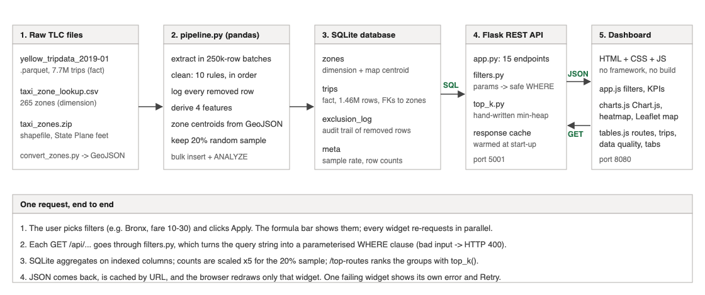
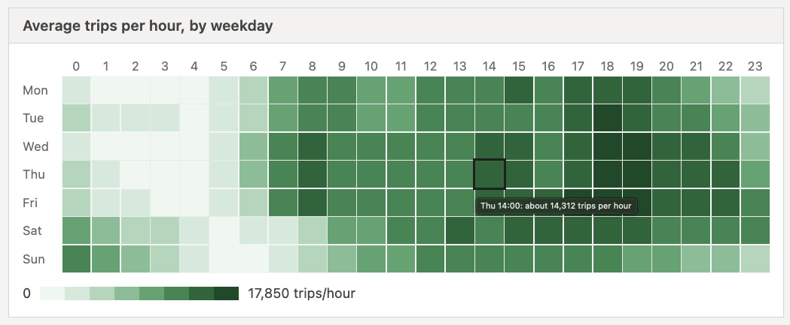

# CityPulse: NYC Taxi Mobility Explorer, Technical Report

All figures below come from the January 2019 Yellow Taxi file and can be regenerated with
`python backend/insights.py`.

## 1. Problem framing and dataset analysis

**Dataset.** The NYC Taxi & Limousine Commission publishes one Parquet file of yellow-taxi trips
per month. I used January 2019: **7,696,617 trips**, each with pickup and dropoff timestamps,
distance, passenger count, payment type and an itemised fare. Two companion files make it a
small star schema: `taxi_zone_lookup.csv` maps the 265 `LocationID`s to a borough and zone name,
and `taxi_zones.zip` holds each zone's boundary polygon.

**Data challenges and how I resolved them.** The pipeline checks every row against ten rules in
a fixed order, and each removed row is logged under the first rule it broke. **394,574 rows
(5.1%) were removed.** Every removed row is counted in `exclusion_log`, with up to 50,000 example
rows kept per rule.

| Rule | Rows removed | Share | Assumption behind the rule |
|---|---:|---:|---|
| `bad_zone` | 187,399 | 2.43% | Zones 264/265 are "Unknown": the trip cannot be placed on a map |
| `outlier_passengers` | 107,166 | 1.39% | 0 or more than 6 passengers is a data-entry error, not a real trip |
| `outlier_distance` | 37,578 | 0.49% | 0 miles (meter never moved) or over 100 miles is not a city taxi trip |
| `missing_values` | 28,672 | 0.37% | All were a missing `passenger_count` |
| `outlier_duration` | 20,033 | 0.26% | Trips over 6 hours are meters left running |
| `outlier_fare` | 8,299 | 0.11% | Fares of $0 or less (refunds) or over $500 |
| `impossible_speed` | 4,599 | 0.06% | An average over 80 mph is physically impossible in NYC |
| `out_of_range_date` | 524 | 0.01% | The January file contains trips from November and December 2018 |
| `non_positive_duration` | 297 | <0.01% | Dropoff at or before pickup |
| `duplicate` | 7 | <0.01% | Same timestamps, zones, fare and distance (checked within each 250k batch) |

I also normalised the data for storage. Timestamps are stored as ISO text. Zone IDs and
passenger counts are integers. Pickup hour, weekday and date are stored as separate columns, so
the API never parses dates per row.

**Derived features.**

- **`avg_speed_mph`** = distance ÷ duration. A congestion proxy: when taxis slow down, the
  streets are full.
- **`fare_per_mile`** = fare ÷ distance. Shows how the minimum fare and time in traffic make short
  trips expensive.
- **`tip_pct`** = tip ÷ fare × 100, for card payments only (see below).
- **`duration_min`**, which the other two need.

**Unexpected observation that changed our design.** Cash trips record an average tip of
**exactly $0.00** (2.0 million trips), against $2.52 for card trips. The meter simply cannot see
cash tips. A naive "average tip %" would therefore be dragged down by 28% of trips that had
no tip *recorded*, not no tip *given*. So `tip_pct` is set to NULL for non-card trips, and the
dashboard labels it "card trips only".

**Suspicious but kept.** Some records pass every rule and are still implausible: a $100 fare for
0.01 miles, and 2,587 sampled trips (about 12,900 in the month) priced above $50 per mile. We kept
them rather than tune thresholds to the data; a fare-per-mile rule is listed under future work.

## 2. System architecture and design decisions



**Stack.**

- **Python + pandas/pyarrow pipeline**, run once. It reads the Parquet file in 250k-row batches,
  so memory stays bounded.
- **SQLite**, a single file with zero setup that is enough for a read-only analytical workload.
- **Flask**, a small, explicit REST API.
- **Plain HTML/CSS/JavaScript with Chart.js and Leaflet**, so there is no build step.
- **The shapefile is reprojected to latitude/longitude** by `convert_zones.py` (pyshp + pyproj).
  The pipeline then computes each zone's centroid by averaging its boundary points. That is our
  programmatic link between trips and the spatial metadata, and it drives the zone map.

**Schema.** The schema is normalised as a star:

- **`zones`** (dimension), with the map centroid.
- **`trips`** (fact), with two foreign keys to `zones`. It is indexed on pickup zone, dropoff
  zone, date, hour, timestamp and fare.
- **`exclusion_log`**, the audit trail.
- **`meta`**, the run facts.

All user input reaches SQL as bound parameters. The only interpolated identifier is a sort column
taken from an allow-list.

**Trade-offs.**

1. **Sampling instead of the full month.** All 7.3M clean trips (1.5 GB) took 20–120 s per query
   on our 8 GB laptops, because the table did not fit in memory. The pipeline therefore still
   *cleans* every row, so the exclusion counts are exact, but stores a seeded random 20% (1.46M
   trips). The API multiplies counts and sums by 5. The estimate is 7,301,645 trips against a true
   7,302,043 (0.005% error). Averages need no scaling.
2. **Query tuning instead of more hardware.**
   - `ANALYZE` took one filtered query from 79 s to 0.03 s.
   - A `CROSS JOIN` hint took the sorted trip list from 45 s to 1 ms.
   - An in-memory response cache, warmed at start-up, makes the default dashboard instant. It is
     safe because the data changes only when the pipeline reruns.
3. **Server-side aggregation everywhere.** Every number on screen comes from SQL with the same
   filters applied, never from a client-side sample. This costs more queries but the numbers are
   always consistent.

## 3. Algorithmic logic: hand-written min-heap top-k

**Problem.** `/api/top-routes` must find the busiest pickup→dropoff pairs. SQL groups the
1.46M trips into **19,769 routes**, and we need only the top *k* (10).

**Approach.** `backend/top_k.py` implements an array-backed binary min-heap (`push`, `pop`,
`peek`, with iterative sift-up and sift-down) without `heapq`, `sorted()` or `.sort()`. It
keeps the *k* best routes seen so far. The root is the weakest of them, so each new route is
compared with one value. Routes are streamed straight from the database cursor.

```
top_k(items, k, key):
    if k <= 0: return []
    heap <- empty min-heap ordered by key
    for item in items:
        if size(heap) < k:              push(item)
        else if key(item) > key(peek): pop(); push(item)
    result <- array of size(heap)
    for slot from last down to 0:       result[slot] <- pop()   # min-heap pops ascending
    return result                                               # largest first
```

**Complexity.** Each item costs at most one pop and one push on a heap of size ≤ k, so time is
**O(n log k)** and extra space is **O(k)**. A full sort is O(n log n) time and O(n) space. Here
log₂ 10 ≈ 3.3 against log₂ 19,769 ≈ 14.3.

**Measured honestly.** On the real 19,769 routes, our heap takes **4.0 ms** and Python's built-in
sort **2.1 ms**, with identical answers. The built-in sort is written in C, and at this size the
constant factor beats the better asymptotics. The heap's real advantages are memory (it never
holds all routes at once) and scaling: its cost grows with log k, not log n.

**Testing.** 12 pytest cases cover:

- heap ordering and the heap invariant;
- an empty heap;
- `k <= 0`, `k > n` and ties;
- generators;
- 200 random lists checked against `sorted()`, which is allowed in tests only.

## 4. Insights

### Insight 1: rush hour halves taxi speed on weekdays


*How:* `/api/by-hour`, the average of the derived `avg_speed_mph` per pickup hour, split
weekday/weekend in `insights.py`. On weekdays taxis average **18.7 mph at 05:00** but only
**9.5 mph at 08:00** and **9.9 mph at 17:00**. At 08:00 on weekends they still do **15.9 mph**. The
heatmap (below) shows the cause: demand jumps at 7–9 am only on weekdays.

*Meaning:* speed falls with commuter demand, not with time of day as such. A ride across
Manhattan at 08:00 on a weekday takes about twice as long as at dawn, which matters for both
fares (time-based meter) and congestion pricing.



### Insight 2: the network is Manhattan short hops, and they cost the most per mile


*How:* `/api/top-routes`, ranked by our heap. Plus `/api/by-borough` and a distance-band query.
**92.7% of pickups are in Manhattan.** The ten busiest routes are all inside Manhattan, mostly
within the Upper East and West Sides, and average **at most 1.1 miles, 4–8 minutes and $5–7**.
Trips under 1 mile are **27.3% of all trips** and cost **$12.93 per mile**, against **$3.00 per
mile** for trips over 10 miles.

*Meaning:* yellow taxis mostly serve very short trips inside dense residential neighbourhoods,
distances that could often be walked, cycled or done by bus. The minimum fare makes them the most expensive
miles in the system. Bike-share and bus planning should target these corridors.

### Insight 3: tipping is recorded only for cards, and rises through the day


*How:* the derived `tip_pct` (card trips only) grouped by time of day. The map's
"Average tip %" view shows the same measure by zone. Card riders tip **20.5% in the morning rush**,
**21.0% at midday**, and **22.5% in the evening rush**. Meanwhile 2.0 million cash trips record
$0.00. The map adds a geography: among zones with at least 100 card trips, Manhattan zones average
a **20.4%** tip, Brooklyn and Queens zones about **8%**, and Bronx zones just **1.7%**.

*Meaning:* evening and leisure riders tip more generously than commuters, and recorded tipping
collapses outside Manhattan. That gap is worth investigating (different riders, or trip types the
meter records differently) before anyone draws conclusions about driver income. More importantly,
about 28% of trips have no tip information at all. Any driver-income analysis built on the raw tip
column underestimates cash-heavy areas and times. Our design keeps that gap visible instead of
hiding it in an average.

## 5. Reflection and future work

**Technical challenges.**

- **Memory.** The full month was too large to query interactively, which led to the sampling and
  query-tuning work in section 2.
- **Spatial data.** The zone file uses NY State Plane feet, not latitude/longitude, and had to be
  reprojected before it could be mapped.
- **Silent rule order.** The rules interact: a row with 0 passengers *and* 0 miles is counted only
  once. Logging the *first* failed rule keeps the totals honest.
- **Testing the frontend.** Every sheet was checked in three states: loaded, an empty filter
  result, and the API offline. Each widget shows its own message instead of a blank page.

**challenges.** _[Most of our debugging time went to small typos. Crashes were easy to find. The silent ones were harder: swapped latitude/longitude, a heap index typo, AND instead of OR in a filter, and CSS that did not apply. I learned to lint with pyflakes, write unit tests (they caught the heap bug), and check every layer against known numbers: the pipeline's exclusion table, curl on the API, then the browser console.]_

**Next steps for a real product.**

1. **Data and scale.**
   - Load all months.
   - Move to PostgreSQL with pre-aggregated hourly or zone tables, or DuckDB, so the full data is
     fast without sampling.
2. **Data quality.**
   - Add a fare-per-mile outlier rule for records like $100 for 0.01 miles.
   - Detect duplicates across batches, not only within one.
3. **Product.**
   - Add authentication.
   - Allow only the production front end to call the API (restrict CORS origins).
   - Run the Flask API under a production server instead of the development one.
   - Add comparisons between months and weather, and "what changed" alerts for city planners.
